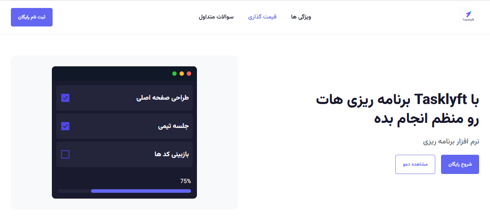

# Tasklyft

Tasklyft, a responsive landing page for task management app built with HTML/CSS/JS

🔗 **Live Demo:** https://amir0rr.github.io/Tasklyft/



## Features
- Fully responsive layout (desktop, tablet, mobile)
- Persian (RTL) support with a custom font (Vazirmatn)
- Animated hero mockup with a progress bar and a JavaScript percentage counter
- Auto-scrolling client logos
- FAQ accordion
- Smooth scrolling between sections
- Sign-up modal with form validation

## Built With
- HTML5
- CSS3 (Flexbox, Grid, media queries, keyframe animations)
- JavaScript (DOM manipulation, events, timers)

## What I Learned
- Building responsive layouts with Flexbox and Grid
- Using media queries for different screen sizes
- Creating CSS animations and syncing them with JavaScript
- Building an FAQ accordion and a modal
- Validating form inputs
- Using Git branches and GitHub Pages

## Run locally
```bash
git clone https://github.com/Amir0rr/Tasklyft.git
```
Then open `index.html` in your browser.